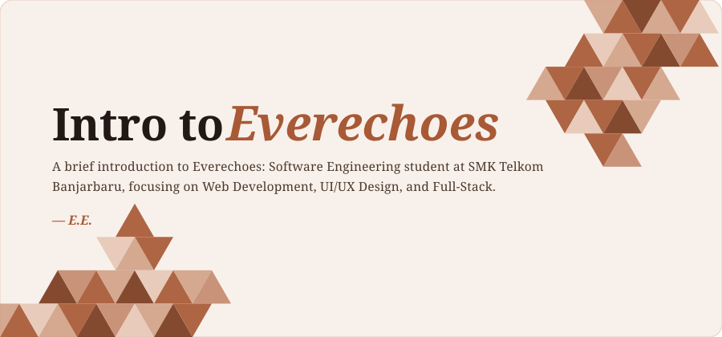

  

  
  
  

---

### 🏛️ About Me

> *"Dedicated to bringing visual ideas to life through robust and interactive web platforms."*

- 🎓 **Education**: Software Engineering student at **SMK Telkom Banjarbaru**
- 🎯 **Current Focus**: Web Development, UI/UX Design, and Full-Stack
- 💡 **Passion**: Designing clean interfaces and turning creative ideas into functional digital experiences

---

### 🛠️ Tech Stack & Disciplines

**Frontend**

  

**Backend & Environment**

  
  

**Database**

  

**Tools & Design**

  

---

### 📜 Featured Archives / Projects

| Project | Description | Status |
| :--- | :--- | :---: |
| 🌐 **[Everechoes.github.io](https://everechoes.github.io)** | Personal portfolio website showcasing web projects & visual designs | `Online` |
| ⏳ **Upcoming Project** | Creative experiment in progress | `Coming Soon` |

---

### 📊 Records & Activity

  
  
  

