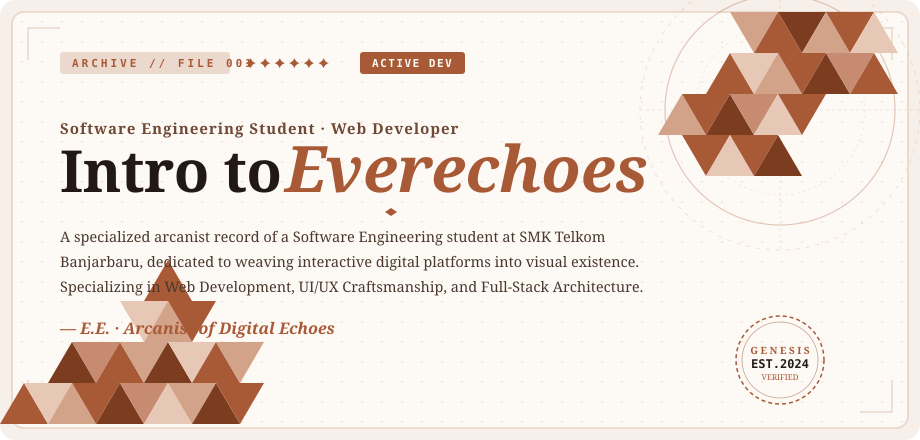
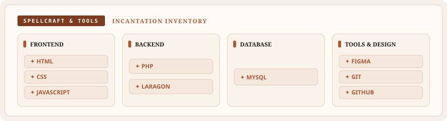

<div align="center">

  <!-- 1. ST. PAVLOV FOUNDATION HEADER BANNER -->
  

  <br/><br/>

  <!-- INTERACTIVE DOSSIER NAVIGATION MENU -->
  <p align="center">
    <a href="#-personnel-file"><b><code>[ 🗂️ PERSONNEL FILE ]</code></b></a> &nbsp;•&nbsp;
    <a href="#-incantation-inventory"><b><code>[ ⚔️ SPELLCRAFT ]</code></b></a> &nbsp;•&nbsp;
    <a href="#-classified-case-files"><b><code>[ 📜 CASE FILES ]</code></b></a> &nbsp;•&nbsp;
    <a href="#-records--activity-archives"><b><code>[ 📊 ARCHIVES ]</code></b></a>
  </p>

  <br/>

  <!-- 2. TELEGRAPH TRANSMISSIONS (Connect With Me) -->
  <a href="https://github.com/Everechoes" target="_blank">
    
  </a>
  &nbsp;
  <a href="https://linkedin.com" target="_blank">
    
  </a>
  &nbsp;
  <a href="https://everechoes.github.io" target="_blank">
    
  </a>

  <br/><br/>

  <!-- 3. OFFICIAL ST. PAVLOV FOUNDATION PASS CARD -->
  <div id="-personnel-file"></div>
  

  <br/><br/>

  <!-- 4. ARCANIST DOSSIER & APTITUDE METRICS (Hover-Interactive) -->
  

  <br/><br/>

  <!-- 5. SPELLCRAFT & INCANTATION INVENTORY (Hover-Interactive) -->
  <div id="-incantation-inventory"></div>
  

</div>

<br/>

---

<div id="-classified-case-files"></div>

### 📂 CLASSIFIED CASE FILES // INTERACTIVE DOSSIER

<details open>
<summary><b>▶ [ CASE FILE #001: THE DIGITAL REALM // PORTFOLIO ] (Click to collapse/expand)</b></summary>
<br/>

```text
┌── CASE FILE #001 ─────────────────────────────────────────────────────────────┐
│  Codename    : THE DIGITAL REALM                                              │
│  Target URL  : https://everechoes.github.io                                   │
│  Lead Dev    : Everechoes (SMK Telkom Banjarbaru)                             │
│  Incantation : HTML5 · CSS3 · Modern JavaScript                               │
│  Objective   : Central portal showcasing visual experiments and web projects   │
│  Status      : [ DEPLOYED // OPERATIONAL ONLINE ]                             │
└───────────────────────────────────────────────────────────────────────────────┘
```

> 🌐 **Live Gateway**: [Visit everechoes.github.io](https://everechoes.github.io)
> 
> *A crafted interactive web platform dedicated to bringing visual ideas into functional digital existence.*

</details>

<br/>

<details>
<summary><b>▶ [ CASE FILE #002: OPERATION COMING SOON ] (Click to decrypt file)</b></summary>
<br/>

```text
┌── CASE FILE #002 ─────────────────────────────────────────────────────────────┐
│  Codename    : UNTITLED PROJECT                                               │
│  Clearance   : LEVEL 4 REQUIRED                                               │
│  Discipline  : Full-Stack Architecture (PHP / MySQL / JavaScript)              │
│  Objective   : Next-generation interactive web application                    │
│  Status      : [ ACTIVE SYNTHESIS // IN DEVELOPMENT ]                         │
└───────────────────────────────────────────────────────────────────────────────┘
```

> 🔒 *Data currently classified under St. Pavlov Foundation protocol. Release scheduled soon.*

</details>

<br/>

<details>
<summary><b>▶ [ TRANSMIT DIRECT TELEGRAPH DISPATCH ] (Click to send transmission)</b></summary>
<br/>

| Channel | Destination / Protocol | Status |
| :--- | :--- | :---: |
| 🐙 **GitHub Repository** | [`github.com/Everechoes`](https://github.com/Everechoes) | `Online` |
| 💼 **LinkedIn Profile** | [`linkedin.com`](https://linkedin.com) | `Available` |
| 🌐 **Personal Web Domain** | [`everechoes.github.io`](https://everechoes.github.io) | `Active` |

</details>

<br/>

---

<div id="-records--activity-archives"></div>

### 📊 RECORDS & ACTIVITY ARCHIVES

<div align="center">
  <table border="0">
    <tr>
      <td align="center" valign="middle">
        <a href="https://github.com/Everechoes">
          
        </a>
      </td>
      <td align="center" valign="middle">
        <a href="https://github.com/Everechoes">
          
        </a>
      </td>
    </tr>
    <tr>
      <td colspan="2" align="center">
        <a href="https://github.com/Everechoes">
          
        </a>
      </td>
    </tr>
  </table>

  <br/>

  <!-- Top Secret Easter Egg Clearance -->
  <details>
    <summary><small><code>[ 🗝️ SECURITY OVERRIDE: CLEARANCE LEVEL 5 ]</code></small></summary>
    <br/>
    <p><i>"Security Clearance Verified. Welcome, Timekeeper Everechoes."</i></p>
    <p><code>STATUS: ALL INCANTATIONS PREPARED. READY FOR MANUSCRIPT DEPLOYMENT.</code></p>
  </details>

  <br/>

  <p align="center">
    <small><code>MUST BE DESTROYED WITH ANIMUS ALIGHT ONCE LOST</code></small>
    <br/><br/>
    <i>"May time turn backward, and the echoes of code remain eternal."</i>
    <br/>
    <b>— Everechoes // SMK Telkom Banjarbaru</b>
  </p>
</div>